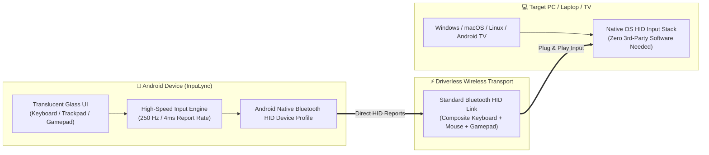

<div align="center">


# ⚡ InpuLync

### Turn Your Android Phone into a High-Performance, Zero-Latency Peripheral
*Driverless Bluetooth HID • 250 Hz Reporting Rate • Sub-Pixel Precision • Zero Cloud • 100% Offline Privacy*

<p align="center">
  <a href="https://github.com/mohammedarsath-ars/InpuLync/releases/latest">
    
  </a>
  
  
  
  
  
</p>

<p align="center">
  <a href="https://github.com/mohammedarsath-ars/InpuLync/releases/latest">
    
  </a>
</p>

</div>

---

> [!IMPORTANT]
> **InpuLync** transforms your Android phone into an ultra-low latency, driverless input peripheral for your PC, laptop, tablet, or TV. Built natively on Android's Bluetooth HID Device profile, your computer sees your phone directly as a physical hardware keyboard, multi-touch trackpad, and DirectInput gamepad. **No PC software, no drivers, no cloud accounts, and zero background telemetry.**

---

## ⚡ System Architecture

InpuLync bypasses intermediate software servers by talking directly to the host operating system's native USB/Bluetooth HID driver stack:



---

## 🚀 Why InpuLync?

| Feature | ⚡ InpuLync | KDE Connect | Unified Remote | Generic Remote Apps |
| :--- | :---: | :---: | :---: | :---: |
| **Air Mouse / Gyro Remote** | ✅ **Built-in Gyro + Slides** | ❌ (None) | ⚠️ (Paid add-on) | ❌ (None) |
| **Driverless Bluetooth HID** | ✅ **Native Hardware Mode** | ❌ (Wi-Fi Only) | ❌ (Server Required) | ❌ (Server Required) |
| **Zero PC Software Needed** | ✅ **None (Zero Install)** | ❌ (Needs PC App) | ❌ (Needs PC App) | ❌ (Needs PC App) |
| **DirectInput Gamepad** | ✅ **PS3 / Xbox Layout** | ❌ | ⚠️ (Paid add-on) | ⚠️ (Requires drivers) |
| **HID Reporting Rate** | ⚡ **250 Hz (4ms)** | ~30–60 Hz | ~30–60 Hz | ~20–50 Hz |
| **Sub-Pixel Trackpad Precision** | ✅ **Float Hermite Accel** | ❌ Coarse integer | ❌ Integer | ❌ Coarse |
| **Zero-Click Auto-Connect** | ✅ **Instant Reconnect** | ⚠️ Network scan | ⚠️ Manual reconnect | ❌ Manual connect |
| **Privacy & Security** | ✅ **100% Offline / No Cloud** | ✅ Local Network | ⚠️ Account / Network | ❌ Cloud / Ads |
| **Translucent Glass Themes** | ✅ **9 Palettes + Aurora** | ❌ Plain | ❌ Plain | ❌ Generic |

---

## ✨ Core Highlights

### 🎯 1. Air Mouse & Presentation Clicker (New in v1.5.0)
- **Mid-Air Gyro Navigation**: Turn your phone into an LG Magic Remote or presentation clicker. Move your wrist naturally to glide the PC mouse cursor across screens with zero PC software.
- **Hold-to-Aim Clutch**: Place your thumb on the center holographic reticle to engage aiming; release to freeze cursor position for repositioning or clicking.
- **World-Space Gravity Projection**: Projects 3D angular velocity onto earth vertical so horizontal sweeps stay horizontal and vertical tilts stay vertical, even when reclining on a bed or sofa.
- **Anti-Jitter Tremor Filter**: Dynamic adaptive low-pass filter with deadzone cancellation removes natural hand tremors while keeping rapid flicks instantaneous.
- **Slide Presentation Deck**: Dedicated clicker controls for PowerPoint, Google Slides, Keynote, and PDF viewers (Next Slide, Prev Slide, F5 Start Slideshow, and 'B' Blank Screen).
- **Couch Media Remote**: Integrated media controls for YouTube, Netflix, and VLC (Play/Pause, Volume, Mute, and Fullscreen toggle).

### 🏎️ 2. Ultra-Low Latency Engine (250 Hz / 4ms)
- **High-Rate Polling**: Input reporting tuned to a 4ms minimum interval (250 reports/sec), delivering instant cursor feedback and competitive responsiveness.
- **Sub-Pixel Motion Math**: Uses high-precision floating-point delta tracking with smooth Hermite velocity interpolation, preventing micro-stutters and coarse stepping.
- **Hardware-Direct Haptics**: Millisecond-accurate vibration pulses delivered straight to the hardware actuator for tactile confirmation.

### ⚡ 2. Zero-Click Auto-Connect & Rapid Recovery
- **Automatic Host Targeting**: If you have a paired PC, InpuLync automatically acquires the connection as soon as you open the app — no menu navigation needed.
- **Instant Wake Reconnect**: Re-establishes the HID session within **300ms** when your laptop wakes from sleep or right after Bluetooth pairing completes.
- **800ms Fast Recovery**: In the event of a signal hiccup, an aggressive 800ms retry schedule reconnects the input session seamlessly.

### 🎮 3. Console-Grade Gamepad
- **Dual Analog Thumbsticks**: Smooth, clickable 360° analog sticks (L3 / R3) for precision movement and camera steering.
- **8-Way Directional D-Pad**: High-visibility cross D-pad with responsive multi-directional chord detection.
- **Customizable Face Buttons**: Switch between PlayStation (`✕ ○ □ △`), Xbox (`A B X Y`), or standard HID numeric (`1 2 3 4`) glyphs.
- **Analog Ramping Triggers**: Smooth graduated trigger pulls for `L2` / `R2` alongside crisp digital bumpers `L1` / `R1`.
- **Steam Input Ready**: Works out of the box with Steam Input and PC emulators. See [Steam Input Setup Guide](docs/steam-input.md).

### ⌨️ 4. Full Workstation Keyboard & Dedicated Numpad
- **Complete Typing Layout**: Modifiers (`Ctrl`, `Alt`, `Shift`, `Caps`, `Win/Super`) with clear visual latch and chord indicators.
- **Dedicated NUMPAD**: Tap **TOOLS ▾ → NUMPAD** for a full numeric keypad with math operators and auto-repeating backspace.
- **International Layouts**: Supports standard US and UK keyboard profiles with localized punctuation keys.

### 📱 5. One-Handed Portrait Remote Mode
Rotate your phone upright for an ergonomic, thumb-driven remote control:
```
┌──────────────────────────────────────┐
│  InpuLync        BT ✓   BAT 85% [⚙]  │
├──────────────────────────────────────┤
│                                      │
│                                      │
│          FULL-SURFACE TRACKPAD       │  [▲]
│        • 1-Finger Tap: Click         │  [█] SCROLL
│        • 2-Finger Drag: Scroll       │  [█] STRIP
│        • 3-Finger Swipe: Desktops    │  [▼]
│                                      │
│                                      │
├──────────────────┬───────────────────┤
│    LEFT CLICK    │    RIGHT CLICK    │
├──────────────────┴───────────────────┤
│     [⏮ PREV]   [⏯ PLAY]   [⏭ NEXT]   │
│         [VOL −]       [VOL +]        │
└──────────────────────────────────────┘
```

### 🎨 6. Translucent Glass Design & Aurora Background
- **9 Handcrafted Color Schemes**: Aurora, Frost, Midnight, Sunset, Ocean, Forest, Sakura, AMOLED (pure black battery saver), and Custom (with a real-time 360° HSV hue slider).
- **Procedural Particle Drift**: An ambient, GPU-accelerated Aurora particle background with a battery-saving motion toggle.

---

## 🛠️ Quick Start Guide

### 📶 Bluetooth Mode (Recommended • Zero Drivers)

1. **Install the APK**: Download **`InpuLync-v1.4.0.apk`** from [Releases](https://github.com/mohammedarsath-ars/InpuLync/releases/latest) and install it on your Android phone (Android 9.0+).
2. **Grant Nearby Devices**: Open InpuLync and grant the Bluetooth Nearby Devices permission.
3. **Make Phone Visible**: Tap **Make phone visible** in the app.
4. **Pair with PC**: On your PC, open Bluetooth Settings $\rightarrow$ Add Device $\rightarrow$ Select your phone and confirm pairing.
5. **Start Controlling**: The top status bar will show **INPUT CONNECTED ✓**. Move your thumb on the screen — your PC mouse moves immediately!

> [!TIP]
> Once paired, **InpuLync auto-connects to your PC every time you open the app**! A lightweight background service keeps the connection alive even when your phone screen turns off.

---

### 🔌 USB Mode (Optional • Secure Loopback)

For environments where Bluetooth is unavailable or disabled, InpuLync provides an authenticated USB loopback tunnel over ADB:

1. Enable **USB Debugging** in Android Developer Options and plug in your USB cable.
2. In the app, switch mode to **USB**.
3. Open **SET → USB PAIR CODE** on the phone and enter the 16-character HMAC code into `windows/Start-UsbInput.ps1` (remembered automatically after first entry).
4. Unlocks laptop brightness control, PC battery telemetry, and Unicode text injection over physical cable.

---

## 🎯 Gesture Reference

| Gesture | Action |
| :--- | :--- |
| **1-Finger Tap** | Left Mouse Click |
| **1-Finger Hold / Double-Tap & Drag** | Drag & Drop / Window Move |
| **2-Finger Tap** | Right Mouse Click |
| **2-Finger Vertical Drag** | Mouse Scroll Wheel (Up / Down) |
| **2-Finger Horizontal Drag** | AC Pan Horizontal Scroll |
| **3-Finger Swipe Left / Right** | Switch Virtual Desktops (`Win + Ctrl + Left/Right`) |
| **3-Finger Swipe Up** | Windows Task View (`Win + Tab`) |
| **3-Finger Swipe Down** | Show / Hide Desktop (`Win + D`) |
| **Dedicated Scroll Strip** | Precision 1-Finger Scrolling with Haptic Clicks |

---

## 🔨 Build from Source

### Requirements
- **JDK 17** (Temurin recommended)
- **Android SDK Platform 35** (Build-tools `35.0.0`)

```bash
# Clone the repository
git clone https://github.com/mohammedarsath-ars/InpuLync.git
cd InpuLync

# Build Debug APK on Linux / macOS
./gradlew assembleDebug

# Build Debug APK on Windows
.\gradlew.bat assembleDebug
```
The compiled APK will be output to `app/build/outputs/apk/debug/InpuLync-v1.4.0.apk`.

---

## 🤝 Contributing

Contributions, bug reports, and pull requests are warmly welcome! Please check out [CONTRIBUTING.md](CONTRIBUTING.md) before getting started. For security concerns, refer to [SECURITY.md](SECURITY.md).

---

## 📄 License

InpuLync is open-source software distributed under the terms of the **[MIT License](LICENSE)**.
Free to use, inspect, modify, and distribute.
